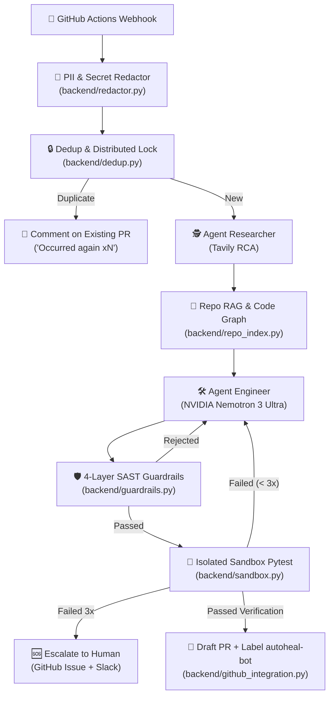

# 🛠️ AutoHeal Data Agent V2 (Enterprise Hardened)

**AutoHeal** is an autonomous AI data engineer (*Autonomous Agentic Engineer*) that automatically detects data pipeline failures in **GitHub Actions**, investigates the root cause (*Root Cause Analysis*), writes and refines source code repairs (*Self-Correction Loop*), validates code safety (*Multi-layer SAST Guardrails*), and verifies fixes in an isolated sandbox (*Docker Pytest Runner*) before opening a governed **Draft Pull Request**.

AutoHeal V2 transforms the original proof-of-concept into an **Enterprise-Grade** system that is secure, repository-aware, anti-spam, and strictly enforces **Zero Blind Trust** on LLM outputs.

---

## 🏗️ System Architecture (LangGraph State Machine)

AutoHeal V2 uses a cyclic state machine built on **LangGraph** with a self-correction feedback loop of up to 3 iterations:



---

## 🌟 Key Capabilities & Enterprise Hardening

| # | Traditional AI Agent Pitfall | AutoHeal V2 Enterprise Solution | Core Module |
|---|---|---|---|
| 1 | **Blind Trust & Hallucinations** (AST check only) | **4-Layer SAST + Destructive Policy:** AST parser, `ruff` (linting), `bandit` (Python security flaws), `semgrep` (SQL injection & command injection), plus a strict denylist against destructive operations (`DROP TABLE`, `DELETE` without WHERE, `rm -rf`). | `backend/guardrails.py`, `semgrep_rules.yml` |
| 2 | **Tunnel Vision / Local-Only Context** (No global awareness) | **Repository Code Graph & Impact Analysis:** Maps all function/class definitions, callers, callees, and imports across files. Rejects patches that break caller function signatures elsewhere in the repository. | `backend/repo_index.py`, `backend/context_retriever.py` |
| 3 | **No Real Testing** (Direct unverified PRs) | **Isolated Sandbox Runner & Self-Correction:** Executes `pytest` inside an isolated Docker container (`--network none`, resource limits, timeout kill). Failures feed back into the LLM up to 3 times with compiler/test diagnostics. | `backend/sandbox.py`, `backend/graph.py` |
| 4 | **PII & Credential Leaks** to external APIs | **Pre-LLM PII & Secret Redaction:** Masks AWS Keys, GitHub Tokens, JWTs, DB Connection URLs, Emails, and Credit Cards before logs reach the LLM, Tavily, or persistent storage. | `backend/redactor.py` |
| 5 | **PR Storms & Race Conditions** in CI/CD | **Error Fingerprinting & Distributed Lock:** Traceback normalization hashing + Redis/In-Memory TTL lock. 12 identical webhooks in 1 minute result in exactly 1 PR and 11 deduplicated PR comments. | `backend/dedup.py`, `backend/rate_limiter.py` |
| 6 | **Uncontrolled PR Delivery** | **Draft PR Governance & Human Review:** All PRs are created as Drafts with the `autoheal-bot` label, include full SAST/Sandbox audit reports, and require human review (no auto-merge). | `backend/github_integration.py` |

---

## 📂 Repository & Module Structure

```text
autoheal-agent/
├── backend/
│   ├── main.py                  # FastAPI Backend: Webhook, /runs, /metrics, /rate-limits
│   ├── graph.py                 # LangGraph Cyclic Orchestration & SQLite Checkpointing
│   ├── redactor.py              # PII & Secret Redaction (Sub-Task 9)
│   ├── dedup.py                 # Error Normalization & Distributed TTL Lock (Sub-Task 10)
│   ├── rate_limiter.py          # PR Quota, GitHub API Backoff & Circuit Breaker (Sub-Task 11)
│   ├── guardrails.py            # 4-Layer SAST & Destructive Operation Policy (Sub-Tasks 12 & 13)
│   ├── sandbox.py               # Docker Isolated Sandbox Runner & Pytest Exec (Sub-Task 14)
│   ├── repo_index.py            # AST Code Graph & Incremental Indexing (Sub-Task 17)
│   ├── context_retriever.py     # Context Retrieval & Signature Impact Analysis (Sub-Task 18)
│   ├── github_integration.py    # GitHub App / Token Auth, PR Governance (Sub-Task 19)
│   ├── agent_researcher.py      # Tavily Root Cause Analysis (Researcher Agent)
│   ├── agent_engineer.py        # NVIDIA Nemotron Repair Generator (Engineer Agent)
│   └── semgrep_rules.yml        # Custom Security Rules (SQL Injection, Dangerous Calls)
├── frontend/
│   └── app.py                   # Streamlit Observability Dashboard (Pipeline + Metrics Tabs)
├── tests/                       # 161+ Automated Unit & Integration Tests
├── docs/                        # Setup Guides & GitHub App Configuration
├── requirements.txt             # Production Dependencies
└── requirements-dev.txt         # Testing & Development Dependencies
```

---

## 📊 Observability Dashboard & Metrics

The Streamlit dashboard (`frontend/app.py`) features a curated **NVIDIA Green Dark Aesthetic** with two primary tabs:

1. **🚀 Tab 1: Pipeline & Run Details:**
   - Select and inspect individual runs by webhook ID.
   - View raw incoming error logs and sanitized logs.
   - Read Root Cause Analysis generated by Agent Researcher.
   - Review AI repair code with syntax-highlighted **Unified Diff**.
   - Inspect 4-layer SAST results and isolated Pytest execution logs.
   - Follow the full self-correction attempt history and direct links to GitHub Draft PRs.

2. **📊 Tab 2: Guardrails & Metrics (Enterprise KPI):**
   - **🎯 Fix Success Rate (%)**: Percentage of actionable runs that successfully resulted in a valid PR.
   - **🔁 Average Iterations**: Efficiency of the self-correction loop before passing tests.
   - **🛡️ SAST Rejections**: Count of dangerous patches intercepted by guardrails.
   - **🧹 Redacted Secrets**: Total sensitive credentials and PII entities safely sanitized.
   - **🔁 Deduplication Saves**: Repeated errors prevented from creating duplicate PR spam.
   - **⚡ & 💰 Token & Cost Estimates**: Real-time token consumption tracking for NVIDIA Nemotron models.

---

## 🚀 Getting Started Locally

### 1. Prerequisites & Installation
Ensure you have Python 3.10+ and Git installed.

```bash
# Clone the repository
git clone https://github.com/Althaf2406/autoheal-agent.git
cd autoheal-agent

# Create and activate virtual environment
python -m venv .venv
# On Windows PowerShell:
.venv\Scripts\Activate.ps1
# On Linux / macOS:
source .venv/bin/activate

# Install dependencies
pip install -r requirements-dev.txt
```

Set up your environment variables:
```bash
cp .env.example .env
```
Fill in the credentials in `.env`:
- `NEBIUS_API_KEY`: API Key for NVIDIA Nemotron 3 Ultra (via Nebius Token Factory).
- `TAVILY_API_KEY`: API Key for Tavily AI Search.
- `GITHUB_TOKEN`: GitHub Personal Access Token (with `repo` permissions).
- `AUTOHEAL_SANDBOX`: `off` (offline default for local dev) or `docker` (runs tests in isolated containers).

---

### 2. Running the Backend (FastAPI)
```bash
uvicorn backend.main:app --reload --port 8000
```
- API Webhook & Swagger Docs: `http://127.0.0.1:8000/docs`
- Aggregated Metrics Endpoint: `http://127.0.0.1:8000/metrics`
- Rate Limiter & Circuit Breaker Status: `http://127.0.0.1:8000/rate-limits`

---

### 3. Running the Observability Dashboard (Streamlit)
In a separate terminal:
```bash
streamlit run frontend/app.py
```
The dashboard will open in your browser at: `http://localhost:8501`

---

### 4. Running Automated Tests
The repository includes **161 automated test cases** covering every module in an offline, isolated environment:

```bash
pytest -v
```

Test coverage includes:
- `test_redactor.py`: Secret and PII masking regex verification.
- `test_dedup.py`: Traceback normalization, fingerprint hashing, and thread-safe lock tests.
- `test_repo_index.py`: AST Code Graph extraction, caller-callee relationships, and incremental indexing.
- `test_context_retriever.py`: Context bundle retrieval and function signature impact analysis.
- `test_guardrails.py`: 4-layer SAST validation and destructive operation denylist enforcement.
- `test_sandbox.py`: Sandbox runner isolation, timeouts, and pytest reproduction.
- `test_rate_limiter.py`: Hourly PR quota, circuit breaker threshold, and exponential backoff.
- `test_graph.py` & `test_pipeline.py`: Full cyclic LangGraph pipeline and FastAPI integration.
- `test_dashboard.py`: Streamlit dashboard rendering, state transitions, and metrics tab.

---

## 🎬 3 Core Demo Scenarios (Hackathon Showcase)

1. **Scenario 1 — Data Privacy & Redaction:**
   Send a simulated webhook containing AWS Keys (`AKIA...`), GitHub personal tokens, and customer email addresses in the stack trace. Observe how the payload is sanitized into safe placeholders before reaching the LLM and stored runs.
2. **Scenario 2 — Guardrail & Self-Correction Loop:**
   Simulate an error that triggers the AI to attempt a dangerous patch (e.g., `DROP TABLE` or SQL f-string injection). Observe how the SAST Guardrail rejects it on Iteration 1, sends diagnostic feedback back to the agent, and the agent successfully produces a parameterized, safe patch on Iteration 2.
3. **Scenario 3 — 12-Webhook Storm Deduplication:**
   Simulate a flurry of 12 identical webhooks fired within 1 minute. Observe how the system opens exactly 1 Draft Pull Request, while the remaining 11 are converted into informative comments (*"Occurred again (x12)"*).

---

## 🛠️ Technology Stack & Ecosystem
- **AI Core:** NVIDIA Nemotron 3 Ultra (via Nebius Token Factory), Tavily AI Search
- **Agent Orchestration:** LangGraph (StateGraph, MemorySaver, SQLite Checkpoint)
- **Security & Guardrails:** Bandit, Ruff, Semgrep, Python AST Analysis, Gitleaks-style Regex
- **Context Engine:** AST Code Graph Traversal, Incremental SHA-256 Hashing
- **Execution Sandbox:** Docker (`--network none`, cgroup resource limits, timeout kill)
- **Backend & APIs:** FastAPI, Uvicorn, Pydantic, Python Dotenv
- **Observability:** Streamlit, Pandas, Altair, NVIDIA Green Theme CSS
- **Integration:** GitHub REST API, PyGithub, GitHub Actions
