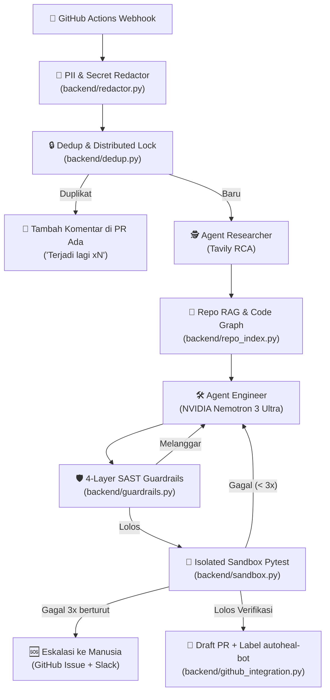

# 🛠️ AutoHeal Data Agent V2 (Enterprise Hardened)

**AutoHeal** adalah agen AI otonom (*Autonomous Agentic Engineer*) yang secara otomatis mendeteksi kegagalan data pipeline di **GitHub Actions**, menganalisis akar masalah (*Root Cause Analysis*), memperbaiki kode sumber (*Self-Correction*), memverifikasi keamanan (*Multi-layer SAST*), dan menguji patch di lingkungan terisolasi (*Docker Sandbox*) sebelum mengirimkan **Draft Pull Request**.

AutoHeal V2 berevolusi dari prototype sederhana menjadi sistem **Enterprise-Grade** yang aman, sadar konteks repositori, anti-spam, dan tidak pernah percaya buta pada LLM (*Zero Blind Trust*).

---

## 🏗️ Arsitektur Sistem V2 (LangGraph State Machine)

AutoHeal V2 menggunakan cyclic state machine berbasis **LangGraph** dengan feedback loop perbaikan mandiri hingga 3 iterasi:



---

## 🌟 Fitur Utama & Enterprise Hardening

| # | Tantangan AI Agen Tradisional | Solusi Enterprise AutoHeal V2 | Modul Utama |
|---|---|---|---|
| 1 | **Halusinasi & Blind Trust** (`ast.parse` saja) | **4-Layer SAST + Destructive Policy:** Lapis AST, `ruff` (linter), `bandit` (celah Python), `semgrep` (SQLi & injeksi perintah), serta denylist operasi destruktif (`DROP TABLE`, `DELETE` tanpa WHERE, `rm -rf`). | `backend/guardrails.py`, `semgrep_rules.yml` |
| 2 | **Agen "Mata Kuda"** (Tanpa konteks repo) | **Repository Code Graph & Impact Analysis:** Memetakan seluruh simbol fungsi, kelas, caller, dan callee. Mencegah perubahan signature fungsi yang merusak file pemanggil di repo. | `backend/repo_index.py`, `backend/context_retriever.py` |
| 3 | **Tanpa Pengujian Nyata** (Langsung buat PR) | **Isolated Sandbox Runner & Self-Correction:** Menjalankan `pytest` di container Docker terisolasi (`--network none`, resource cap, timeout). Jika gagal, feedback dikirim kembali ke LLM hingga 3 iterasi. | `backend/sandbox.py`, `backend/graph.py` |
| 4 | **Kebocoran Data & Secrets** ke API luar | **Pre-LLM PII & Secret Redactor:** Menyaring AWS Key, GitHub Token, JWT, DB Credentials URL, Email, dan Kartu Kredit dari log error sebelum dikirim ke LLM / Tavily / storage. | `backend/redactor.py` |
| 5 | **Bom PR & Race Condition** di CI/CD | **Error Fingerprinting & Distributed Lock:** Hashing normalisasi error traceback + Redis/In-Memory TTL lock. 12 webhook error yang sama hanya menghasilkan 1 PR dan 11 komentar. | `backend/dedup.py`, `backend/rate_limiter.py` |
| 6 | **Tata Kelola PR (Governance)** | **Draft PR & Human Review:** Semua PR berstatus Draft, berlabel `autoheal-bot`, menyertakan laporan SAST & Sandbox, dan wajib di-review manusia (tanpa auto-merge). | `backend/github_integration.py` |

---

## 📂 Struktur Repositori & Modul

```text
autoheal-agent/
├── backend/
│   ├── main.py                  # FastAPI Backend: Webhook, /runs, /metrics, /rate-limits
│   ├── graph.py                 # LangGraph Cyclic Orchestration & SQLite Checkpointing
│   ├── redactor.py              # PII & Secret Redaction (Sub-Task 9)
│   ├── dedup.py                 # Error Normalization & Distributed TTL Lock (Sub-Task 10)
│   ├── rate_limiter.py          # PR Quota, GitHub API Backoff & Circuit Breaker (Sub-Task 11)
│   ├── guardrails.py            # 4-Layer SAST & Destructive Operation Policy (Sub-Task 12 & 13)
│   ├── sandbox.py               # Docker Isolated Sandbox Runner & Pytest Exec (Sub-Task 14)
│   ├── repo_index.py            # AST Code Graph & Incremental Indexing (Sub-Task 17)
│   ├── context_retriever.py     # Context Retrieval & Signature Impact Analysis (Sub-Task 18)
│   ├── github_integration.py    # GitHub App / Token Auth, PR Governance (Sub-Task 19)
│   ├── agent_researcher.py      # Tavily Root Cause Analysis (Researcher)
│   ├── agent_engineer.py        # NVIDIA Nemotron Repair Generator (Engineer)
│   └── semgrep_rules.yml        # Custom Security Rules (SQL Injection, Dangerous Calls)
├── frontend/
│   └── app.py                   # Streamlit Observability Dashboard (Pipeline + Metrics Tab)
├── tests/                       # 161+ Unit & Integration Test Cases
├── docs/                        # Setup Panduan GitHub App & Dokumentasi
├── requirements.txt             # Dependensi Produksi
└── requirements-dev.txt         # Dependensi Testing & Pengembangan
```

---

## 📊 Dashboard Observabilitas & Metrik

Dashboard Streamlit (`frontend/app.py`) memiliki 2 tab utama bertema **NVIDIA Green Dark Aesthetic**:

1. **🚀 Tab Pipeline & Run Details:**
   - Memilih run per webhook.
   - Menampilkan log error asli dan log tersanitasi.
   - Root Cause Analysis dari Agent Researcher.
   - Kode hasil perbaikan AI beserta visualisasi perbandingan (*Unified Diff*).
   - Status 4 lapis SAST Guardrails dan hasil eksekusi Pytest di Sandbox.
   - Riwayat loop iterasi (*self-correction timeline*) dan link live Pull Request di GitHub.

2. **📊 Tab Guardrails & Metrics (Enterprise KPI):**
   - **Fix Success Rate (%)**: Rasio perbaikan otomatis yang berhasil menghasilkan PR.
   - **Rata-rata Iterasi**: Efisiensi loop *self-correction* sebelum lolos.
   - **Patch Ditolak SAST**: Jumlah kode berbahaya yang berhasil dicegat.
   - **Rahasia Ter-Redact**: Jumlah total kredensial & PII yang diamankan.
   - **Duplikat Dicegah**: Efektivitas anti-spam deduplikasi error.
   - **Estimasi Token & Biaya**: Pemantauan konsumsi token model NVIDIA Nemotron.

---

## 🚀 Cara Menjalankan Secara Lokal

### 1. Prasyarat & Instalasi
Pastikan Python 3.10+ dan Git sudah terpasang.

```bash
# Clone repository
git clone https://github.com/Althaf2406/autoheal-agent.git
cd autoheal-agent

# Buat virtual environment & install dependensi
python -m venv .venv
# Windows PowerShell:
.venv\Scripts\Activate.ps1
# Linux / macOS:
source .venv/bin/activate

pip install -r requirements-dev.txt
```

Salin file lingkungan:
```bash
cp .env.example .env
```
Isi konfigurasi di `.env`:
- `NEBIUS_API_KEY`: API Key untuk NVIDIA Nemotron 3 Ultra.
- `TAVILY_API_KEY`: API Key untuk search Tavily.
- `GITHUB_TOKEN`: Personal Access Token GitHub (izin `repo`).
- `AUTOHEAL_SANDBOX`: `off` (default untuk development offline) atau `docker` (untuk runner Docker terisolasi).

---

### 2. Menjalankan Backend (FastAPI)
```bash
uvicorn backend.main:app --reload --port 8000
```
- API Webhook & Docs berjalan di: `http://127.0.0.1:8000/docs`
- Endpoint Metrik: `http://127.0.0.1:8000/metrics`
- Endpoint Rate Limiter: `http://127.0.0.1:8000/rate-limits`

---

### 3. Menjalankan Dashboard Observabilitas (Streamlit)
Di terminal baru:
```bash
streamlit run frontend/app.py
```
Dashboard akan otomatis terbuka di browser pada: `http://localhost:8501`

---

### 4. Menjalankan Rangkaian Pengujian Otomatis (Testing)
Proyek ini dilengkapi dengan **161 automated test cases** yang menguji seluruh lapisan sistem secara offline dan terisolasi:

```bash
pytest -v
```

Hasil pengujian mencakup:
- `test_redactor.py`: Pengujian masking rahasia & PII.
- `test_dedup.py`: Pengujian hashing traceback, normalisasi angka, dan thread-safe lock.
- `test_repo_index.py`: Pengujian AST Code Graph, caller-callee, dan incremental index.
- `test_context_retriever.py`: Pengujian context retrieval dan signature impact analysis.
- `test_guardrails.py`: Pengujian 4 lapis SAST dan denylist operasi destruktif.
- `test_sandbox.py`: Pengujian isolasi runner sandbox dan eksekusi pytest.
- `test_rate_limiter.py`: Pengujian kuota PR, circuit breaker, dan exponential backoff.
- `test_graph.py` & `test_pipeline.py`: Pengujian end-to-end alur cyclic LangGraph dan FastAPI endpoints.
- `test_dashboard.py`: Pengujian render frontend Streamlit dan tab Guardrails & Metrics.

---

## 🎬 3 Skenario Demo Utama (Hackathon Showcase)

1. **Skenario 1 — Data Privacy & Redaction:**
   Kirim webhook berisi error traceback yang memuat AWS Key (`AKIA...`), token GitHub, dan email pelanggan. Amati bagaimana payload ke LLM dan log dashboard otomatis tersanitasi menjadi placeholder aman.
2. **Skenario 2 — Guardrail & Self-Correction:**
   Simulasikan error yang membuat AI mencoba menghasilkan patch destruktif (`DROP TABLE` atau f-string SQL). Amati bagaimana Guardrail menolaknya pada Iterasi 1, mengirimkan feedback ke AI, dan AI memperbaikinya menjadi kueri aman pada Iterasi 2.
3. **Skenario 3 — 12-Webhook Storm Deduplication:**
   Simulasikan 12 webhook error yang datang serentak dalam 1 menit. Amati bagaimana sistem hanya membuka 1 Pull Request, sementara 11 lainnya dikonversi menjadi komentar informatif *"Terjadi lagi (x12)"*.

---

## 🛠️ Tech Stack & Ekosistem
- **AI Core:** NVIDIA Nemotron 3 Ultra (via Nebius Token Factory), Tavily AI Search
- **Agent Orchestration:** LangGraph (StateGraph, MemorySaver, SQLite Checkpoint)
- **Security & Guardrails:** Bandit, Ruff, Semgrep, AST Analysis, Regex Masking
- **Context Engine:** AST Code Graph Traversal, Incremental SHA-256 Hashing
- **Execution Sandbox:** Docker (`--network none`, cgroups cap, timeout kill)
- **API & Backend:** FastAPI, Uvicorn, Pydantic, Python Dotenv
- **Observability:** Streamlit, Pandas, Altair, NVIDIA Dark Theme CSS
- **Integration:** GitHub REST API, PyGithub, GitHub Actions
